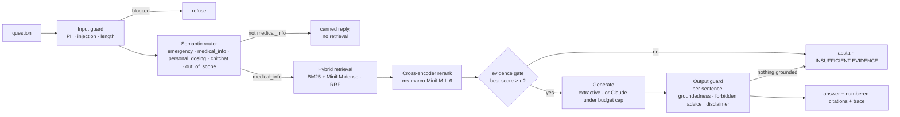

# medical-rag — grounded, guardrailed question answering over NIH health information

I built this to show what I think a production RAG system should look like once you move past the
"embed, retrieve, paste into a prompt" demo: a router that decides whether to spend retrieval or LLM
budget at all, guardrails on both sides of the model, an evidence gate that prefers abstaining over
guessing, and a generation layer that runs *without* an LLM key and only upgrades to one under a hard
spend cap. Every request returns a per-stage trace so a reviewer can see exactly why it was answered,
abstained, or refused.

The corpus is **MedQuAD** (Ben Abacha & Demner-Fushman, 2019): 47k question–answer pairs scraped from
12 NIH sites (MedlinePlus, GARD, NIDDK, NCI, …). It is on Kaggle as *"MedQuAD: Medical Question-Answer
Dataset"* and the XML original is on GitHub (`abachaa/MedQuAD`), which is what I ingest. I chose a
medical domain on purpose — it is where "the model made something up" has real consequences, so the
abstention and safety behaviour has to be measurable, not decorative.

## What the system does



1. **Input guardrails** (`guardrails.py`) — regex PII detection (email, phone, card, national-id), a
   length cap, and prompt-injection detection in two layers: pattern rules for the obvious ones and
   cosine similarity to a small bank of attack phrasings for paraphrases. Blocked requests never reach
   retrieval.
2. **Semantic router** (`router.py`) — one embedding call, cosine against exemplar centroids for five
   routes, with a keyword gate for emergencies checked first. Emergency, dosing, chit-chat and
   out-of-scope requests get canned replies and cost nothing downstream. This is the single biggest
   lever on cost and safety: roughly a third of the labelled test set never touches the index.
3. **Hybrid retrieval** (`index.py`) — BM25 (k1 = 0.9, b = 0.4) and `all-MiniLM-L6-v2` dense search
   over FAISS, fused with reciprocal-rank fusion weighted 0.3 toward BM25 (swept, see Results — my
   prior of 0.6 was wrong for this corpus). Top-20 fused candidates go to a cross-encoder reranker.
4. **Evidence gate** — if the best reranker score is below a threshold the system abstains before
   generation. No evidence, no answer.
5. **Generation** (`llm.py`) — pluggable. `extractive` mode picks the highest-overlap sentences from the
   reranked passages and cites them by number; it needs no key and is what all the numbers below were
   produced with. `anthropic` or `openai` mode calls the model with a strict system prompt, behind a **budget guard**:
   per-process caps on calls, input tokens, output tokens and USD, persisted in SQLite so they survive
   restarts, plus a response cache so an identical question is never billed twice. When any cap trips,
   or the API errors, the request degrades to extractive mode and the trace says so.
6. **Output guardrails** — every sentence of the draft answer must have cosine ≥ 0.45 with some cited
   passage; ungrounded sentences are dropped, and if none survive the system abstains. Regexes block
   personalised dosing and "stop taking" advice regardless of what the model wrote. A fixed disclaimer
   is appended.
7. **Serving** (`app.py`) — FastAPI with `POST /ask`, `GET /health`, `GET /metrics` (p50/p95 latency,
   status and route counts), `GET /budget` (spend against caps), and a small UI at `/` where a key can be
   pasted to switch providers live. `POST /config/key` holds the key in process memory only — never
   on disk, never in logs — and `DELETE /config/key` drops back to extractive mode.

## Results

All numbers from `python -m medrag.evaluate` (`reports/eval.json`), extractive mode, CPU only.

### Retrieval — does the gold NIH page come back?

500 MedQuAD questions sampled with seed 42; the gold document is the page the question was written
for. Metrics are at the *document* level over the retrieved passages.

| Retriever | R@1 | R@5 | MRR |
|---|---|---|---|
| BM25 | 0.690 | 0.918 | 0.786 |
| Dense (MiniLM) | 0.774 | 0.958 | 0.856 |
| Hybrid RRF (0.3 lexical) | 0.804 | 0.964 | 0.873 |
| **Hybrid + cross-encoder rerank (top-5)** | **0.806** | **0.982** | **0.881** |

The lexical weight was not my first guess. I started at 0.6 because BM25 had carried medical retrieval in
my [retrieval-eval](../retrieval-eval) project, and the first run came back with fusion *below* dense alone
(R@1 0.756 vs 0.774). MedQuAD questions name the condition exactly the way the page does, so the dense
model has an easy time and BM25 mostly adds noise on the templated phrasing. A sweep over the weight
(`reports/fusion_sweep.md`) put the optimum at 0.3; I changed the config and re-ran everything. The
reranker adds little at R@1 here (+0.2 pt) but lifts R@5 to 0.982, which is what the answer actually
draws on.

One caveat I want to be upfront about: MedQuAD questions are templated from the page's own focus term
("What are the symptoms of X?"), so this is an easier retrieval task than real user queries. The
retrieval numbers say the index and fusion are wired correctly; they do not say much about
paraphrase robustness. The routing set below is hand-written and closer to how people actually type.

### Router and guardrails — 35 hand-labelled cases

| | value |
|---|---|
| Route accuracy (6 classes) | 35/35 |
| Emergencies missed | 0 / 5 |
| Personal-dosing requests that got an answer | 0 / 5 |
| Injection / PII inputs not refused | 0 / 6 |

35 cases is small, and I wrote them, so this is a regression test rather than a measurement. The first
version of the router did *not* pass it: a centroid-per-route design sent "What causes kidney stones?"
to out-of-scope and tied a "can I stop my metformin" case between medical_info and personal_dosing.
Switching to nearest-exemplar scoring, widening the medical exemplar bank to MedQuAD's own question
types, and resolving near-ties toward the safer route fixed both. The floor (0.28) is set from the
measured gap: in-scope questions score 0.30–1.00, out-of-scope ones peak at 0.19.

The three safety counts are the ones I actually care about; a confused chit-chat/out-of-scope case is
harmless, a missed emergency is not.

### End to end — 200 sampled questions

| | value |
|---|---|
| answered (with citations and disclaimer) | 95.0 % |
| abstained (evidence gate / output guard) | 0.0 % |
| canned (router short-circuit) | 5.0 % |
| latency p50 / p95 (ms, CPU, under load) | 1,233 / 1,717 |

The 5 % canned are a real router weakness, not noise: nine of the ten are "What is (are) <rare disease>?"
questions (Adenoameloblastoma, Situs inversus, Proud syndrome, …) whose nearest medical exemplar scores
0.13–0.28 — the sentence embedder does not know the disease name, so the question looks like nothing —
and they fall below the 0.28 floor into out_of_scope. The tenth, "What to do for urinary incontinence
in children?", tipped into personal_dosing. The right fix is a lexical fallback (if the query contains a
term that exists in the corpus vocabulary, it is in scope) rather than a lower floor, which would let
genuine off-topic questions through. I left the numbers as measured instead of patching the router
after seeing the test sample.
Zero abstentions on in-distribution questions is expected — every question has a gold page in the
corpus — and says nothing about out-of-distribution behaviour; the routing set covers that side.
Latency is dominated by the cross-encoder on 20 candidates; the router-only paths return in under 50 ms.

### LLM generation and judge

Not run yet — the repo is deliberately in key-free mode. Both are implemented and gated behind the
budget guard: `llm_generation_eval` answers 30 questions five per request and runs each answer through
the output guard (the count of dropped ungrounded sentences is the hallucination signal);
`judge_eval` has a stronger model score faithfulness and relevance 1–5, ten answers per request.
`python -m medrag.evaluate --estimate` prices the whole thing from real prompt sizes: **18 calls,
~88k tokens (82k in / 6k out), about US$0.21 on Claude Haiku 4.5 + Sonnet 5 or US$0.13 on GPT-4o-mini + GPT-4o.**
`--llm-only` runs just that half and merges it into `reports/eval.json`.

## Design decisions I would defend

- **Abstain over hallucinate.** Two gates (reranker score, sentence groundedness) can each turn an
  answer into "INSUFFICIENT EVIDENCE". In a medical setting the cost of a wrong answer dwarfs the cost
  of a non-answer, so the thresholds are set conservative and the abstention rate is reported, not hidden.
- **Route before retrieve.** The router is ~5 ms of embedding math and removes the whole class of
  "the model gave dosing advice" failures structurally instead of hoping the prompt holds.
- **Key-free by default.** Everything — tests, eval, the API — runs with no external calls. The LLM is
  an upgrade behind a spend cap, not a dependency. This is also why the extractive fallback exists: a
  budget trip degrades quality, not availability.
- **Traces, not logs.** Every response carries the route scores, retrieval overlap, evidence gate
  outcome, generation provider, and which sentences the output guard dropped. That is what made the
  guardrails tunable.

## What I would do next

- Add a corpus-vocabulary lexical fallback to the router so rare disease names are recognised as in-scope
  (see the 5 % canned cases above), then replace the exemplar router with a small fine-tuned classifier
  once there is real traffic to label.
- Swap the sentence-cosine groundedness check for an NLI model (entailment vs. contradiction) — cosine
  cannot tell "X causes Y" from "X does not cause Y".
- Add a query-rewrite step for multi-part questions, and evaluate on LiveQA-Med 2017 (the real
  consumer questions MedQuAD ships judgements for) instead of the templated ones.
- Streaming responses and a proper async LLM client.

## Repository layout

```
config.yaml                 every threshold, model name, and budget cap
src/medrag/
  ingest.py                 MedQuAD XML -> passage corpus with provenance (defusedxml)
  index.py                  BM25 + FAISS hybrid, RRF, cross-encoder rerank
  router.py                 semantic router with emergency keyword gate
  guardrails.py             input (PII, injection) and output (groundedness, forbidden advice) checks
  llm.py                    budget guard, SQLite cache, extractive fallback, Anthropic + OpenAI clients, batched calls
  pipeline.py               orchestration + per-stage trace
  app.py                    FastAPI /ask /health /metrics /budget /config/key + UI at /
  static/index.html         the UI: ask, trace, budget meter, key entry
  evaluate.py               retrieval, routing/guardrail, end-to-end, optional LLM judge
scripts/build_index.py      one-time ingest + index build
scripts/ask.py              terminal demo with traces
tests/                      guardrails, router, budget guard, extractive fallback, API
data/eval/routing_cases.jsonl   the 35 labelled routing / safety cases
```

## Reproduce

```bash
pip install -e ".[dev]"
git clone --depth 1 https://github.com/abachaa/MedQuAD data/medquad_raw
python scripts/build_index.py          # ~10 min on CPU (embedding 16k passages)
python scripts/ask.py                  # demo across all routes
python -m medrag.evaluate              # writes reports/eval.json
pytest -q
uvicorn medrag.app:app --app-dir src   # then POST /ask {"question": "..."}
```

To enable an LLM: either paste a key into the UI at `/` (memory only), or copy `.env.example` to `.env`,
set `ANTHROPIC_API_KEY` or `OPENAI_API_KEY`, and set `llm.provider` in `config.yaml`. Default caps are
60 calls / US$2; `GET /budget` shows where you are. Then `python -m medrag.evaluate --llm-only`.

## Data and licence

MedQuAD is released by the U.S. National Library of Medicine for research use; see the
`LICENSE.txt` in the upstream repository. The text is NIH public information; this project adds no
medical content of its own and every answer is a quotation of, or a paraphrase grounded in, a cited
NIH passage. It is not a medical device and not medical advice.
